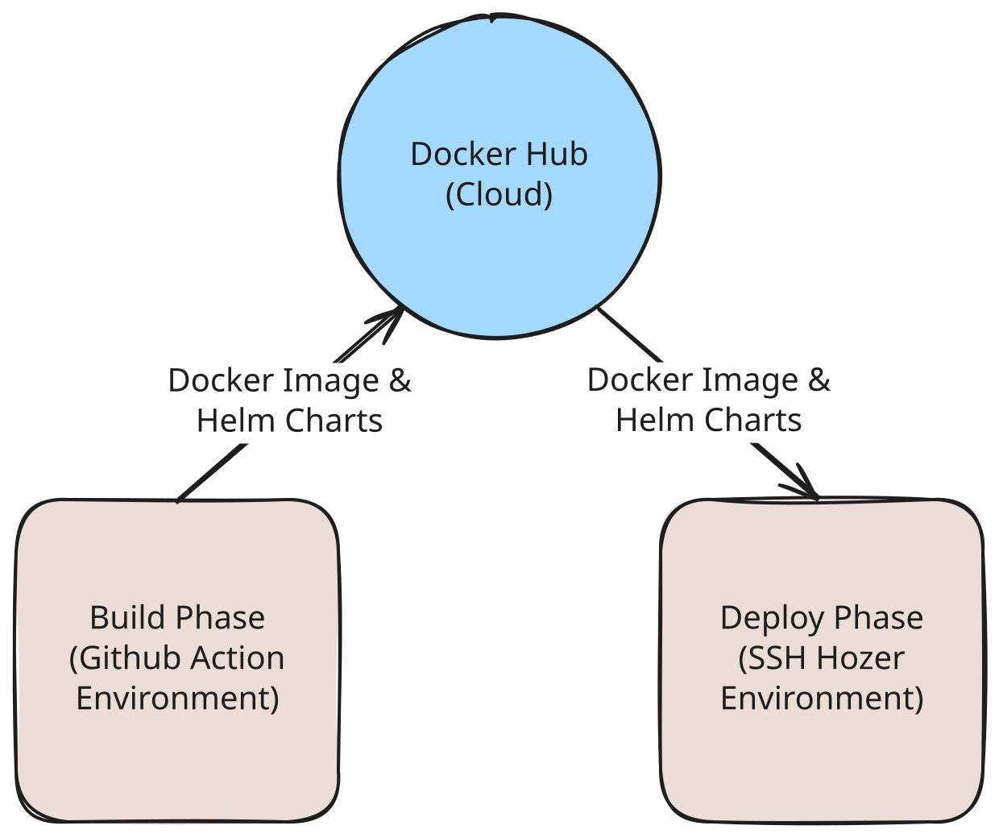

# Deployment Environments & CI/CD Workflow

<!-- toc -->

## What are Deployment Environments?

Berkeleytime has three deployment environments: production, staging, and development. The production environment refers to the live deployed website seen by users of Berkeleytime and should contain code already tested in the other two environments. The staging and development environments are primarily used by Berkeleytime developers/designers to test new code.
- **Production**: Finalized changes merged in `main` are *manually* deployed here at [berkeleytime.com](https://berkeleytime.com)
- **Staging**: Changes already merged in `main` are *automatically* deployed here at [staging.berkeleytime.com](https://staging.berkeleytime.com)
- **Development**: Specific git branches can be *manually* deployed here.

## The CI/CD Github Actions

We use GitHub actions to build our CI/CD workflows.[^1] All three CI/CD workflows[^2] are fairly similar to each other and can all be broken into two phases: the build and the deploy phase.

1. **Build Phase**: An application container and Helm chart are *built* and *pushed* to a registry. We use [Docker Hub](https://hub.docker.com/). This process is what `.github/workflows/cd-build.yaml` is responsible for and is run in the Github Action environment.

2. **Deploy Phase**: After the container and Helm chart are built and pushed to a registry, they are *pulled* and *deployed* onto `hozer-51`. This process is what `.github/workflows/cd-deploy.yaml` is responsible for and is run in the Github Action environment `ssh`'d into `hozer-51`.

    

### Comparing Deployment Environment Actions

The differences between the three environments are managed by each individual workflow file: `cd-dev.yaml`, `cd-stage.yaml`, and `cd-prod.yaml`.

| | Development | Staging | Production |
| --- | --- | --- | --- |
| k8s Pod Prefix | `bt-dev-*` | `bt-stage-*` | `bt-prod-*` |
| Container Tags | `[commit hash]` | `latest` | `prod` |
| Helm Chart Versions[^3] | `0.1.0-dev-[commit hash]` | `0.1.0-stage` | `1.0.0` |
| TTL (Time to Live) | `[GitHub Action input]` | N/A | N/A |
| Deployment Count Limit | 8 | 1 | 1 |
| Datapuller `suspend` | `true` | `false` | `false` |

## Infra Releases

The Deploy Phase above covers the app, AG, staff and observability charts. The other Helm releases (`bt-base` with the backups, MetalLB and certificate issuer, plus Mongo and Redis for production and staging) are managed by a separate workflow, `.github/workflows/cd-infra.yaml` (**CD: Infra Releases**). Before it existed they were installed once by hand from `infra/init.sh`, so changes to `infra/base`, `infra/mongo` and `infra/redis` never reached the cluster and the cluster drifted from the repository.

The workflow has two steps:

1. **Diff**: compares what a release has deployed with what the repository would deploy. It runs on pull requests that touch those charts, every Monday for every release (failing if the cluster no longer matches `main`), and on demand.
2. **Apply**: only on demand, only after the diff succeeds, and only after someone approves the `production` or `staging` environment. It packages the chart with a version that identifies the commit, pushes it to the registry, and runs `helm upgrade` on `hozer-51`.

The diff comes first because applying changes the live cluster. Mongo and Redis restart when their pod spec changes, and a Redis restart logs every user out. These releases used to be edited by hand, so the cluster and the repository can differ, and applying makes the cluster match the repository: that can overwrite a manual fix or change an image. The diff shows exactly what will change, and it is what the approver reads before approving. If the cluster cannot be reached (for example, the `HELM_DIFF_KUBECONFIG` secret expired), the run fails at the diff, before anything is changed.

See [Deploying Infra Releases](./runbooks.md#deploying-infra-releases) for how to run it, and [Regenerating the `HELM_DIFF_KUBECONFIG` Secret](./runbooks.md#regenerating-the-helm_diff_kubeconfig-secret) for when the diff cannot reach the cluster.

[^1]: In the past, we have used a self-hosted GitLab instance. However, the CI/CD pipeline was obscured behind a admin login page. Hopefully, with GitHub actions, the deployment process will be more transparent and accessible to all engineers. Please don't break anything though!

[^2]: Development, Staging, and Production

[^3]: Ideally, these would follow [semantic versioning](https://semver.org/), but this is rather difficult to enforce and automate.
