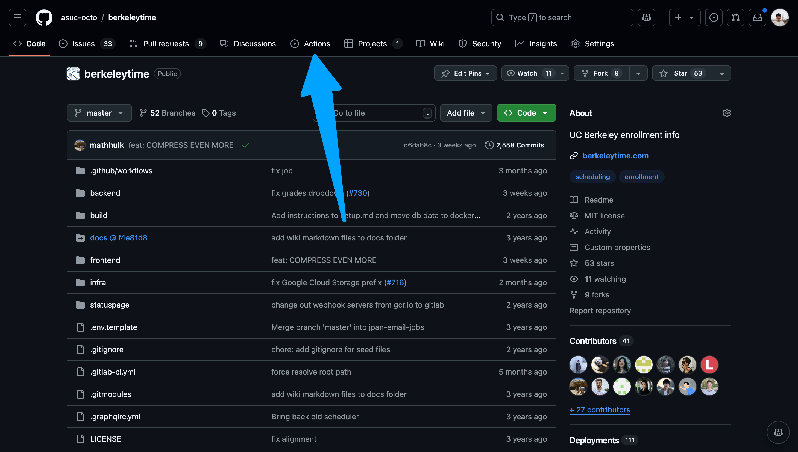
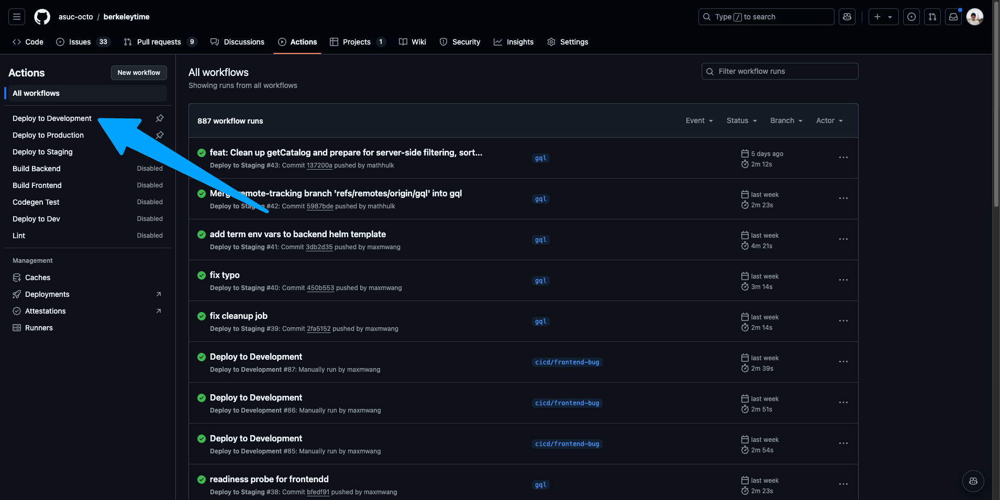
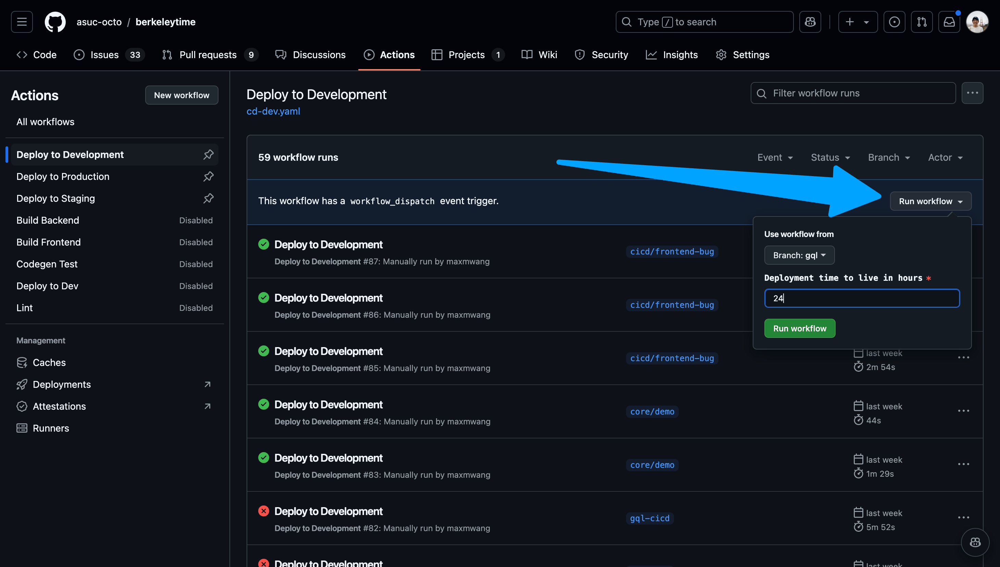
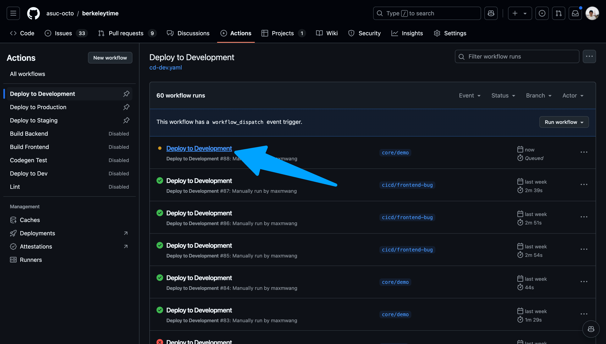
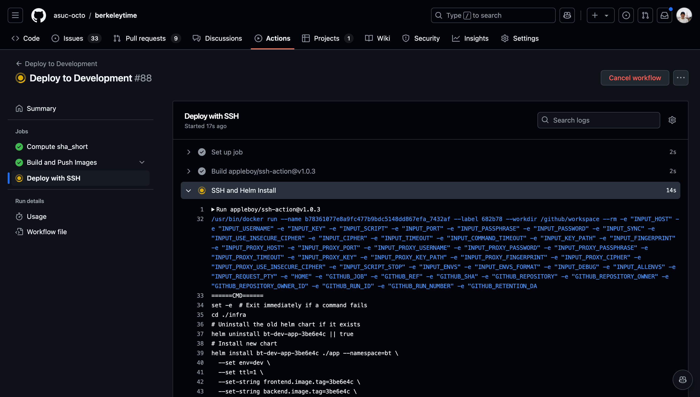
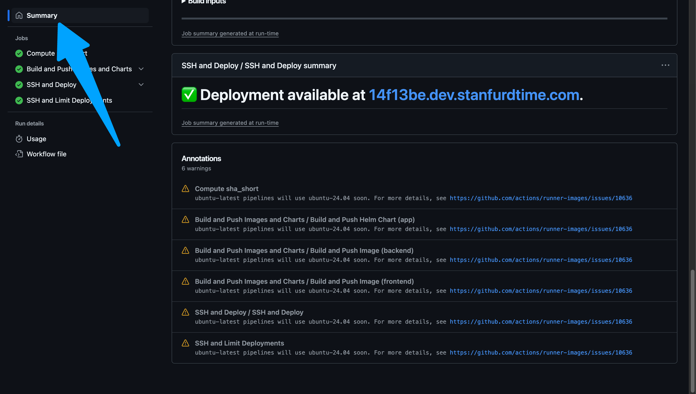

# Contributing & Development Workflow

<!-- toc -->

This is the standard way a change moves from an idea to berkeleytime.com. It is
the same for every pod and for every tool you use to write code, including AI
agents. The short version lives in the repository's `CONTRIBUTING.md`; the
rules of the codebase itself live in `AGENTS.md`.

## 1. Pick up work

- Work comes from the pod's board (Linear tickets such as `BER-78`) or a GitHub issue. If there is no ticket, write two sentences in the PR description that would have been the ticket.
- Make sure your local environment is set up ([Local Development](./local-development.md)) and `main` is up to date: `git switch main && git pull`.

## 2. Branch

```sh
git switch -c <you>/<ticket>-<short-slug>     # e.g. ethan/ber-78-former-names
```

One change per branch. A PR over roughly 400 changed lines, or one that mixes a
refactor with a feature, gets split. Reviewers can only hold so much in their head.

## 3. Build the change

- Start from the nearest existing module, page or component and copy its pattern. `AGENTS.md` lists the patterns and the traps.
- GraphQL changes: edit `packages/gql-typedefs`, run `npm run generate`, implement, add the operation in `lib/api/`, run `npm run generate` again and `npm run generate:operations`, commit the generated allowlist.
- Add or update a unit test next to the code. Fixing a bug without a test that would have caught it is half a fix.
- Update docs in the same PR when behavior, commands or structure change: `apps/docs/src` and `AGENTS.md`.

### Working with AI tools

Agents are fast and confidently wrong. Make them work for you:

- Give the tool the ticket, the files involved, and the existing pattern to copy. Constrain scope: "only the backend", "do not touch generated files".
- It must run `npm run check` and fix what fails, not skip tests or add `eslint-disable`.
- You read the whole diff before you push. You own the behavior, not the tool.
- If a procedure is worth repeating, write it as a skill under `.claude/skills/` so the next person does not re-prompt it from scratch.

## 4. Run the gate locally

```sh
npm run check     # persisted operations, migration sync, prettier, type-check, lint, unit tests
npm run format    # fixes formatting
```

This is exactly what CI runs. If it is green here, it is green there. The
optional `pre-commit install` hook runs format and lint on push as a reminder.

## 5. Open the pull request

- Use the PR template: what changed and why, how to test, the checklist.
- Title in the imperative with the ticket prefix. It becomes the commit message on `main`.
- UI changes: screenshots in light and dark mode. Anything a reviewer should click through: [deploy it to development](#deploying-with-cicd) and link the URL.
- Keep it a draft until it is ready; CI does not run on drafts.

CI runs four workflows ([details](../core/infrastructure/cicd-workflow.md#checks-on-every-pull-request-ci)). All of them must be green.

## 6. Review

- One approval from a pod lead or an experienced member. `CODEOWNERS` (once the teams are filled in) requests the right people automatically.
- Reviewers read the diff, run it when the change is risky, and ask "would I understand this in a year?" Style comments go through Prettier and ESLint, not review threads.
- Address every comment with a commit or a reply. Re-request review after pushing.

## 7. Merge

Squash merge. Delete the branch. Staging deploys automatically from `main`
within a few minutes.

## 8. Verify and release

1. Check your change on [staging.berkeleytime.com](https://staging.berkeleytime.com).
2. Run **CD: Deploy to Production** from the Actions tab (the `production` environment may require an approval). Production deploys the main app, the staff dashboard and the AG dashboard together because they share the persisted-operation allowlist.
3. Watch the deploy summary and Grafana for a few minutes. If something is wrong, re-run the previous production deploy or fix forward; do not leave it.

## Weekly hygiene (leads)

- Merge or close Dependabot's grouped PRs (Monday).
- Delete merged and abandoned branches; the repo had over 200 remote branches in October 2026.
- Skim open PRs older than two weeks: merge, give a decision, or close with a note.

## Deploying with CI/CD

The deployment process is different for [development](#development), [staging](#staging), and [production](#production) environments.
- **Development**: Best for short-term deployments to simulate a production environment as closely as possible. Useful for deploying feature branches before merging into `main`.
- **Staging**: The last "testing" environment to catch bugs before reaching production. Reserved for the latest commit on `main`.
- **Production**: User facing website! Changes being pushed to production should be thoroughly tested on a developer's local machine and in development and staging environments.

To learn more about how our CI/CD pipelines work, head to the [infra section's overview of CI/CD](../core/infrastructure/cicd-workflow.md).

### Development

1. Go to the [actions page](https://github.com/asuc-octo/berkeleytime/actions).
    <details><summary>Image</summary>

    

    </details>

2. Ensure "Deploy to Development" is the selected action on the left sidebar.
    <details><summary>Image</summary>

    

    </details>

3. Navigate to the "Run workflow" dropdown on the right. Select your branch and input a time to live in hours. Please keep this value a reasonable number. If you need to login, for example you want to test a scheduler feature, select "Enable authentication support".
    <details><summary>Image</summary>

    

    </details>

4. Once the action starts running, click into the action and watch the status of each step. If the deployment fails, the action will fail as well.
    <details><summary>Images</summary>

    
    You can view the logs of each step by navigating the left sidebar.
    

    </details>

5. After the action succeeds, go to `abcdefg.dev.berkeleytime.com`, where `abcdefg` is the first 7 characters of the latest commit's hash. A hyperlink to the deployment is also available near the bottom of the Summary page of the workflow run. At most 8 development deployments exist at a time; the oldest is removed automatically.

    <details><summary>Image</summary>

    

    </details>

### Staging

The staging CI/CD pipeline is automatically run on every push to `main` (docs-only changes are skipped). The staging website can be viewed at `staging.berkeleytime.com`.

### Production

The production CI/CD pipeline is manually run with a process similar to the development pipeline. However, the production pipeline can only be run on `main`.
